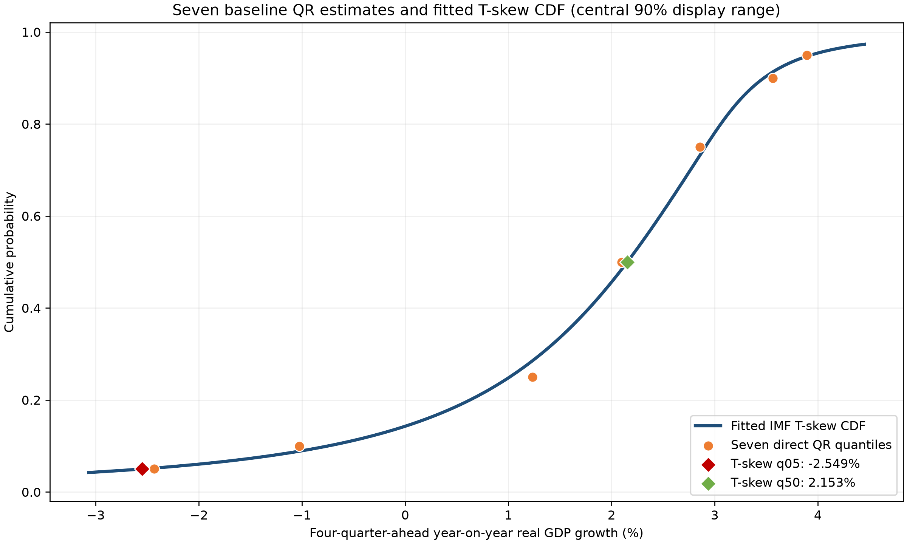
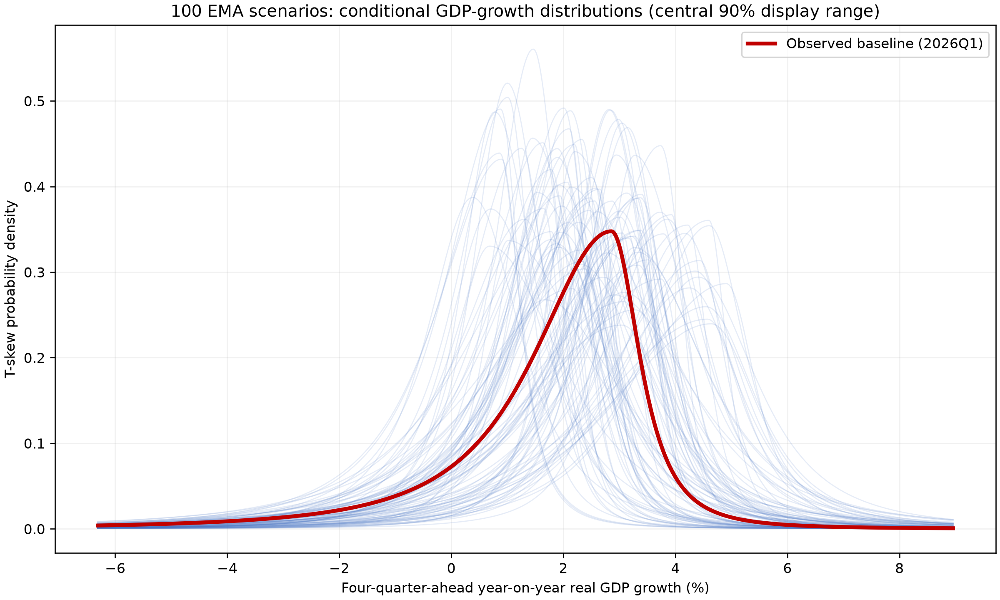
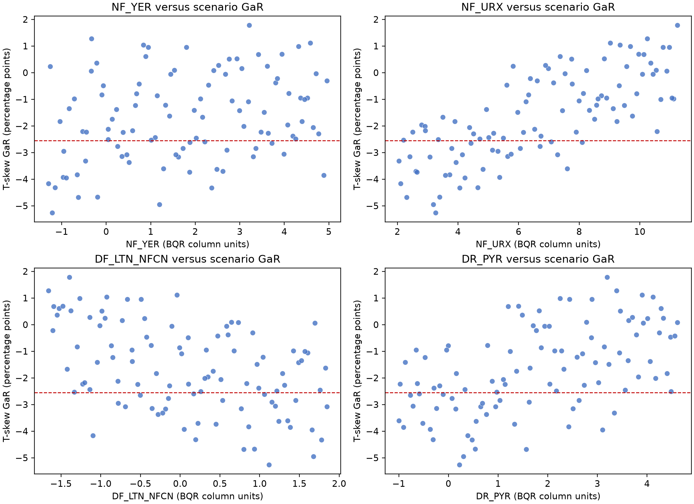

# Presentation outline: Exploring Input Uncertainty in Macro-at-Risk Models

**Audience:** MSc Engineering & Policy Analysis thesis supervisors, TU Delft / DNB
**Structure:** Eight slides, following one baseline GaR model from specification through scenario-group comparisons.
**Research reference:** Ossandon Busch et al. (2022), “Growth at risk: Methodology and applications in an open-source platform,” *Latin American Journal of Central Banking*. [https://doi.org/10.1016/j.latcb.2022.100068](https://doi.org/10.1016/j.latcb.2022.100068)

> **Method distinction:** The paper is a conceptual and methodological reference. Its implementation uses non-parametric distribution fitting; this repository uses the IMF implementation's parametric T-skew fit. Figures in this outline are generated from the DNB model and its saved results, not copied from the paper.

## Slide 1 — Exploring Input Uncertainty in Macro-at-Risk Models

**Main takeaway:** EMA can help explore how uncertain macro-financial inputs change the downside-risk assessment from a Macro-at-Risk model.

**Slide content**

- **MaR/GaR:** Estimate the conditional distribution of a future macroeconomic outcome given current conditions; Growth-at-Risk (GaR) emphasizes a lower-tail GDP growth measure.
- A conditional distribution communicates both a central outcome and downside risk, unlike a point forecast alone.
- The result depends on the input vector. Exploring alternative inputs helps show how robust a tail-risk assessment is to input uncertainty.
- **Research objective:** Investigate how Exploratory Modeling and Analysis (EMA) can explore input uncertainty in MaR models, using the existing IMF-based Dutch GDP GaR model as the initial example.
- **Story:** `Understand one GaR model → change its inputs → compare conditional risk outcomes → investigate input uncertainty using EMA`

**Visual**

Use a simple flow:

```text
Current macro-financial inputs → Conditional future GDP-growth distribution
                                      → Downside tail-risk measure
                         EMA explores alternative input combinations
```

**Speaker notes**

The objective is not to maximize forecast accuracy. It is to understand how the model translates conditions into a conditional growth distribution, and then to explore whether different plausible inputs materially change the implied tail risk. The next slides first explain the one existing model and its baseline forecast; EMA is introduced only after that forecast is clear.

**Sources and references**

- Research framing: `README.md`, `METHODOLOGY.md`.
- Ossandon Busch et al. (2022), DOI above; conceptual motivation for conditional distributions and GaR.

## Slide 2 — Baseline Growth-at-Risk Model

**Main takeaway:** One quantile-regression specification forecasts `NF_YER` four quarters ahead from four current BQR inputs.

**Slide content**

| Element | Existing specification |
|---|---|
| Data | `BQR data yoy.xlsx`, worksheet `data_yoy` |
| Target | `NF_YER` at \(t+4\) |
| Predictors at \(t\) | `NF_YER`, `NF_URX`, `DF_LTN_NFCN`, `DR_PYR` |
| Horizon | Four quarters |
| Estimation sample | 217 origin–target observations |
| Estimation method | IMF-based quantile regressions, estimated separately at seven quantiles |

Let \(Y_{t+4}=\texttt{NF\_YER}_{t+4}\). For each quantile level \(\tau\), the actual model specification is:

\[
\begin{aligned}
Q_{\tau}(Y_{t+4}\mid X_t)
={}&\beta_{0,\tau}
+\beta_{1,\tau}\texttt{NF\_YER}_{t}
+\beta_{2,\tau}\texttt{NF\_URX}_{t}\\
&+\beta_{3,\tau}\texttt{DF\_LTN\_NFCN}_{t}
+\beta_{4,\tau}\texttt{DR\_PYR}_{t}.
\end{aligned}
\]

The fitted direct fifth-percentile equation is:

\[
\begin{aligned}
Q_{0.05}(Y_{t+4}\mid X_t)
={}&-5.855645
+0.295874\,\texttt{NF\_YER}_{t}
+0.458065\,\texttt{NF\_URX}_{t}\\
&-0.787512\,\texttt{DF\_LTN\_NFCN}_{t}
+0.371629\,\texttt{DR\_PYR}_{t}.
\end{aligned}
\]

- `NF_YER` has two roles: current GDP growth is a predictor at \(t\), and future GDP growth is the dependent variable at \(t+4\).
- The seven fitted \(\tau\) values are 0.05, 0.10, 0.25, 0.50, 0.75, 0.90, and 0.95.
- Coefficients depend on \(\tau\); the displayed fifth-percentile regression is not by itself the complete conditional distribution.
- Forecast-origin sample: 1971Q1–2025Q1; corresponding target dates: 1972Q1–2026Q1.

**Visual**

Show a four-quarter timeline with all predictors at \(t\) and `NF_YER` as the target at \(t+4\). Place the numerical \(\tau=0.05\) equation alongside it.

**Speaker notes**

Explain the time indexing carefully: the model uses current GDP growth as one predictor, but predicts GDP growth observed four quarters later. It is a single linear quantile-regression specification fitted separately for each \(\tau\), producing different intercepts and slopes across the conditional distribution. The coefficients are conditional associations, not causal effects.

**Sources and references**

- `GAR/dnb_gar.py`: `PREDICTORS`, `DEPENDENT_VARIABLE`, `QUANTILES`, `DEFAULT_HORIZON`.
- `results/quantile_regression_coefficients.csv`: verified fifth-percentile coefficients.
- `results/quantile_regression_diagnostics.csv`, `results/in_sample_conditional_quantiles.csv`: estimation count and date ranges.
- `BQR data yoy.xlsx`, sheet `data_yoy`.
- Ossandon Busch et al. (2022), Figure 4 (page 6) for quantile-regression intuition.

## Slide 3 — From Quantile Regressions to a Conditional Growth Distribution

**Main takeaway:** Seven conditional QR predictions for one input vector are fitted with the IMF parametric T-skew method to obtain one complete conditional distribution.

**Slide content**

1. Estimate the seven quantile regressions on the historical sample.
2. Insert one observed input vector \(X_t\).
3. Evaluate each fitted regression to obtain seven conditional quantile predictions.
4. Fit the IMF T-skew distribution to those seven predictions.
5. Use the resulting distribution to calculate its quantiles and probabilities.

\[
\widehat{Q}_{\tau}^{\,QR}(X_t)
\quad(\tau=0.05,\ldots,0.95)
\ \longrightarrow\
\widehat{F}_{T}(\,\cdot\mid X_t;\widehat{loc},\widehat{scale},
\widehat{skew},\widehat{df}\,)
\]

- Orange points in the figure are the **seven direct QR predictions** at their associated cumulative probabilities.
- The continuous curve is the **fitted T-skew CDF**, evaluated using the actual baseline parameters and the IMF CDF function.
- The red diamond marks the fitted T-skew fifth percentile, \(-2.549\%\); the green diamond marks its median, \(2.153\%\).
- The direct QR fifth percentile is \(-2.433\%\). It can differ from the fitted T-skew fifth percentile because the T-skew fit reconciles all seven QR estimates rather than simply copying one QR output.

**Figure**



The display is zoomed to the common central 90% range for readability; the plotted distribution itself is the existing IMF T-skew distribution.

**Speaker notes**

Emphasize that the fifth-percentile regression alone is only one conditional quantile. The full distribution is introduced by fitting a T-skew curve to all seven estimates. The reference paper's Figure 5 also illustrates the idea of constructing a distribution from estimated quantiles, but its fitted distribution is non-parametric; the curve shown here is the IMF T-skew fit and is calculated from this repository's actual baseline outputs.

**Sources and references**

- `GAR/dnb_gar.py`: `DNBGrowthAtRisk.predict`.
- `GAR/tsfit/tskewfit.py`: `tskew_fit`.
- `GAR/tsfit/tskew.py`: `tskew_cdf`, `tskew_ppf`.
- `results/latest_forecast.csv`, `results/presentation_figures/figure_quantiles_to_tskew_cdf.png`.
- Ossandon Busch et al. (2022), Figures 4–5 (pages 6 and 8), conceptual reference only.

## Slide 4 — Interpreting a Single Growth-at-Risk Forecast

**Main takeaway:** The baseline forecast is one conditional distribution for the 2026Q1 input vector and a 2027Q1 GDP-growth target.

**Slide content**

| Baseline output | Estimate |
|---|---:|
| Forecast origin → target | 2026Q1 → 2027Q1 |
| Direct QR fifth percentile | −2.433% |
| Fitted T-skew fifth percentile (GaR) | −2.549% |
| Fitted T-skew median | 2.153% |
| T-skew probability of negative growth | 14.3% |

- In the PDF, the x-axis is four-quarter-ahead year-on-year real GDP growth; the y-axis is probability density.
- The leftmost 5% of the fitted distribution is the model-implied lower tail. GaR is the threshold at its fifth percentile: outcomes below it account for 5% of this conditional distribution.
- The negative-growth probability is a different quantity: the CDF evaluated at growth \(=0\%\).
- The CDF shows the same fitted baseline distribution from a cumulative-probability perspective.

**Figures**

1. Existing PDF: `results/latest_conditional_distribution.png` (do not overwrite).
2. New CDF: `results/presentation_figures/figure_baseline_conditional_cdf.png`.

The new CDF figure uses the same saved baseline T-skew parameters as the existing PDF and forecast output. Its visible x-axis focuses on the central 90% range; its CDF is evaluated from the same IMF function.

**Speaker notes**

This is the complete interpretation of one forecast before moving to EMA. The fifth percentile and probability of negative growth answer different questions: the first is a growth threshold, while the second is probability mass below zero. This is a conditional model estimate, not an unconditional probability and not a claim about forecast accuracy.

**Sources and references**

- `results/latest_forecast.csv`: baseline date, direct and fitted quantiles, probability, and T-skew parameters.
- `results/latest_conditional_distribution.png`.
- `results/presentation_figures/figure_baseline_conditional_cdf.png`.
- `GAR/tsfit/tskew.py`: IMF `tskew_cdf`.
- Ossandon Busch et al. (2022), Figures 1, 3, and 7 (pages 2, 5, and 10), conceptual references.

## Slide 5 — From DNB Data to a GaR Forecast: Python Implementation

**Main takeaway:** A thesis-specific adapter loads and aligns DNB inputs, then calls the original IMF quantile-regression and T-skew routines.

**Slide content**

### 1. Predictors and data loading

`GAR/dnb_gar.py` — thesis-specific adapter:

```python
PREDICTORS = ("NF_YER", "NF_URX", "DF_LTN_NFCN", "DR_PYR")
DATA_SHEET = "data_yoy"

data = pd.read_excel(workbook_path, sheet_name=sheet_name)
```

`run_dnb_gar.py` supplies `BQR data yoy.xlsx` as the default workbook.

### 2. Four-quarter target alignment

`GAR/dnb_gar.py`, `prepare_horizon_data`:

```python
prepared[TARGET_COLUMN] = data[dependent_variable].shift(-horizon)
prepared[TARGET_DATE_COLUMN] = pd.Series(
    data.index, index=data.index
).shift(-horizon)
```

### 3. Quantile-regression estimation

`GAR/dnb_gar.py`, `DNBGrowthAtRisk.fit`; estimator in `GAR/quantfit/quantilereg.py`:

```python
regression = QuantileReg(
    TARGET_COLUMN,
    indvars=list(self.predictors),
    quantile_list=list(self.quantiles),
    data=training,
    scaling=False,
    alpha=0.1,
)
```

### 4. Input vector, T-skew fit, and output

`GAR/dnb_gar.py`, `DNBGrowthAtRisk.predict`:

```python
scenario = pd.DataFrame([values], columns=self.predictors)
quantile_values = {
    q: float(result.predict(scenario).iloc[0])
    for q, result in self.regression.qfit_dict.items()
}
distribution = tskew_fit(quantile_values.copy(), _TSKEW_FIT_PARAMETERS)
```

```python
"qr_q05": latest_prediction["quantile_regression"][0.05],
"tskew_q05_GaR": latest_prediction["distribution_quantiles"][0.05],
"probability_growth_below_zero": latest_prediction[
    "probability_growth_below_zero"
],
```

The new input vector enters the **already fitted** regression at `result.predict(scenario)`; the QR coefficients are not refitted for that vector.

**Implementation boundary**

- **Thesis-specific:** `run_dnb_gar.py` and `GAR/dnb_gar.py` handle data loading, quarterly alignment, information cutoff, model interface, and output writing.
- **IMF methods reused:** `GAR/quantfit/quantilereg.py`, `GAR/tsfit/tskewfit.py`, and `GAR/tsfit/tskew.py`.
- **Separate EMA layer:** `analysis/run_ema_sampling.py` supplies alternative inputs to the fitted adapter. It does not replace the baseline runner or IMF methods.

**Speaker notes**

Walk left to right from the BQR worksheet to the final outputs. The adapter defines the DNB data and timing; the imported IMF routines do the regression and T-skew fitting. EMA calls the adapter's prediction interface with a different predictor mapping after one historical fit.

**Sources and references**

- `run_dnb_gar.py`.
- `GAR/dnb_gar.py`: `load_dnb_data`, `prepare_horizon_data`, `DNBGrowthAtRisk.fit`, `DNBGrowthAtRisk.predict`, `write_model_results`.
- `GAR/quantfit/quantilereg.py`: `QuantileReg`.
- `GAR/tsfit/tskewfit.py`: `tskew_fit`.
- `GAR/tsfit/tskew.py`: IMF T-skew density and distribution functions.

## Slide 6 — Exploring Input Uncertainty with EMA Workbench

**Main takeaway:** With the baseline model fitted once, 100 alternative input vectors yield 100 conditional growth distributions—not 100 equally probable GDP outcomes.

**Slide content**

```text
Fit GaR once on 217 historical observations
        ↓ keep fitted QR coefficients fixed
EMA Workbench: 100 independent Latin Hypercube input vectors
        ↓ existing DNBGrowthAtRisk.predict(input vector)
Seven predicted quantiles → one IMF T-skew distribution per vector
```

**Experiment settings**

- EMA Workbench **3.0.0**; Latin Hypercube Sampling; **100** scenarios; seed **20261103**.
- Each input was sampled independently between its empirical BQR 5th and 95th percentiles:

| Input | Empirical 5th–95th percentile bounds |
|---|---:|
| `NF_YER` | −1.341 to 4.957 |
| `NF_URX` | 1.979 to 11.300 |
| `DF_LTN_NFCN` | −1.668 to 1.871 |
| `DR_PYR` | −1.046 to 4.654 |

- The figure overlays all 100 scenario-specific T-skew PDFs and highlights the observed 2026Q1 baseline.
- Curves are reconstructed from the saved scenario-specific IMF T-skew parameters; no normal approximation is used.
- Input bounds and independence are provisional exploratory assumptions. Sampled combinations may not preserve economic dependencies, are not equally likely futures, and the scenario distribution is not a calibrated predictive distribution.

**Figure**



The figure displays the common central 90% range for legibility; all PDF normalization checks use the full support.

**Speaker notes**

EMA changes the input vector, not the estimated relationship. The 100 lines are 100 model-conditional distributions for alternative inputs. They should not be read as 100 random draws of future GDP or as a probability distribution over plausible futures. The sampling bounds and independence assumption need substantive validation.

**Sources and references**

- `analysis/run_ema_sampling.py`: one fit, LHS setup, seed, prediction callback, saved scenario parameters.
- `analysis/build_presentation_figures.py`: distribution reconstruction and validation.
- `results/ema_sampling/run_metadata.json`, `results/ema_sampling/scenario_results.csv`.
- `results/presentation_figures/figure_100_scenario_conditional_pdfs.png`.
- Ossandon Busch et al. (2022), methodological context for GaR; this EMA sampling design is the thesis proof of concept.

## Slide 7 — Input Sensitivity: Which Variables Are Associated with Tail Risk?

**Main takeaway:** In this sampled design, several inputs are associated with scenario GaR; the positive unemployment association is counterintuitive and merits investigation.

**Slide content**



- Each dot is one complete scenario. The x-axis varies one predictor; the other three inputs also vary across dots.
- The y-axis is the scenario's fitted T-skew fifth-percentile GaR. The horizontal red dashed line is baseline GaR, \(-2.549\%\).
- Descriptive Spearman associations across the 100 scenarios:

| Input | Spearman association with scenario GaR |
|---|---:|
| `NF_YER` | +0.261 |
| `NF_URX` | **+0.745** |
| `DF_LTN_NFCN` | −0.450 |
| `DR_PYR` | +0.531 |

- Higher unemployment is associated with a **higher (less negative) GaR** in these sampled combinations. This is economically counterintuitive and should be treated as a question for interpretation and model/design review—not as an isolated causal effect.
- These are univariate associations over one independent LHS design, not causal effects or formal global sensitivity rankings.

**Speaker notes**

Keep the existing scatterplot. Point out that each marker is a full four-variable scenario, so the plotted bivariate relation also reflects changes in the other predictors. The positive unemployment association is particularly important to discuss: it may reflect conditional-regression structure, interactions implicit in simultaneous input variation, or the provisional sample design. The plot alone does not distinguish these explanations.

**Sources and references**

- Existing figure retained: `results/ema_sampling/figure2_inputs_vs_gar.png`.
- `results/ema_sampling/scenario_results.csv`.
- `results/presentation_figures/scenario_spearman_associations.csv`.
- `results/presentation_figures/presentation_figure_validation.json`.

## Slide 8 — Comparing Adverse and Favorable Input Regions

**Main takeaway:** The lowest- and highest-GaR groups produce different conditional distribution mixtures, but this selected-group comparison is descriptive rather than causal or predictive.

**Slide content**

Rank the 100 scenarios by fitted T-skew GaR. Define the 10 lowest-GaR scenarios as the **adverse group**, and the 10 highest-GaR scenarios as the **favorable group**. “Adverse” and “favorable” refer only to this GaR ranking; they do not establish economic plausibility or welfare effects. Keep the observed 2026Q1 baseline separate.

For group \(G\) with ten scenario CDFs:

\[
F_G(y)=\frac{1}{10}\sum_{i\in G}F_i(y),
\qquad
f_G(y)=\frac{1}{10}\sum_{i\in G}f_i(y).
\]

The mixture fifth percentile solves \(F_G(q_{0.05,G})=0.05\) and is found by numerical root-finding. It is not the average of the ten individual fifth percentiles.

| Conditional distribution | Individual GaR range | Mean individual GaR | Mixture q05 | Mean individual \(P(Y<0)\) | Mixture \(P(Y<0)\) |
|---|---:|---:|---:|---:|---:|
| Baseline (2026Q1) | −2.549% | −2.549% | −2.549% | 14.29% | 14.29% |
| Adverse 10 | −5.258% to −3.854% | −4.410% | **−4.418%** | 27.10% | 27.10% |
| Favorable 10 | 0.610% to 1.780% | 1.010% | **0.989%** | 2.42% | 2.42% |

The mean negative-growth probability equals the mixture CDF at zero because both use equal weights. The mixture q05, by contrast, is obtained by inverting the average CDF and differs from the mean individual GaR in both groups.

**Figures**

1. PDF comparison: `results/presentation_figures/figure_adverse_favorable_mixture_pdfs.png`.
2. CDF comparison: `results/presentation_figures/figure_adverse_favorable_mixture_cdfs.png`.

Both figures show the baseline and equally weighted 10-scenario mixtures. The visible x-range is the central 90% display range; normalization and inversion were checked on the actual T-skew functions.

**Interpretation and next steps**

- The scenario groups are selected using GaR itself. They illustrate conditional tail outcomes; they do not show which inputs caused the outcomes.
- Equal weighting within deliberately selected groups is a descriptive aggregation, not a calibrated predictive distribution of future GDP.
- Next: confirm input definitions and transformations; validate bounds; investigate realistic predictor dependencies; conduct formal sensitivity analysis; consider PRIM for adverse scenario discovery; then test additional MaR target variables.

**Speaker notes**

Explain the different meanings of the reported statistics. “Mean individual GaR” averages the ten scenario fifth percentiles. “Mixture q05” instead forms one equally weighted mixture distribution and locates its fifth percentile. The negative-growth probability is linear in the CDF, so its mixture value equals the average scenario probability. These groups are chosen by GaR ranking, so avoid causal language and present the exercise as preparation for formal sensitivity analysis and PRIM.

**Sources and references**

- `results/ema_sampling/scenario_results.csv`.
- `results/presentation_figures/adverse_favorable_scenario_members.csv`.
- `results/presentation_figures/adverse_favorable_group_summary.csv`.
- `results/presentation_figures/presentation_distribution_summary.csv`.
- `results/presentation_figures/presentation_figure_validation.json`.
- `analysis/build_presentation_figures.py`: group selection, equal-weight mixture CDF/PDF, and `scipy.optimize.brentq` inversion.
- Ossandon Busch et al. (2022), Figures 1, 3, and 7 for conditional-distribution interpretation; its non-parametric fitting method is distinct from this IMF T-skew model.

## Reproducibility and presentation files

Run the analysis from the repository root with the project's configured Python environment:

```powershell
python analysis/build_presentation_figures.py
```

The script reads, but does not overwrite, `results/latest_forecast.csv` and `results/ema_sampling/scenario_results.csv`. It fits the baseline model once to verify that the saved baseline and scenario outputs correspond to the current data and inputs; it then evaluates each saved input through the already fitted model, without refitting coefficients per scenario. All new figures, validation results, correlations, group memberships, and summaries are written to `results/presentation_figures/`.

### Figure filenames for the slide deck

- Slide 3: `figure_quantiles_to_tskew_cdf.png`
- Slide 4: `results/latest_conditional_distribution.png` and `figure_baseline_conditional_cdf.png`
- Slide 6: `figure_100_scenario_conditional_pdfs.png`
- Slide 7: `results/ema_sampling/figure2_inputs_vs_gar.png` (retained existing figure)
- Slide 8: `figure_adverse_favorable_mixture_pdfs.png` and `figure_adverse_favorable_mixture_cdfs.png`

### Scientific reference

Ossandon Busch et al. (2022). “Growth at risk: Methodology and applications in an open-source platform.” *Latin American Journal of Central Banking*. [https://doi.org/10.1016/j.latcb.2022.100068](https://doi.org/10.1016/j.latcb.2022.100068). Figures 1, 3, 4, 5, and 7 are conceptual references as identified in the corresponding slides; the paper's non-parametric fitted distributions are not the parametric IMF T-skew distributions used here.
